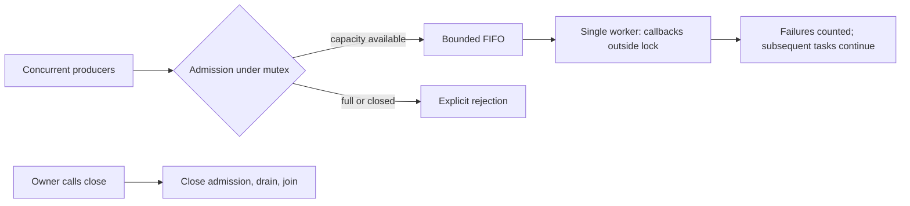

# C++ worker lifecycle

A small C++20 reliability demonstration: bounded work admission, deterministic shutdown, explicit ownership and failure isolation. Built for inspection in Visual Studio on Windows, with portable core code.

**Portfolio demonstration, not client source code.** This repository illustrates an implementation and its trade-offs; it does not claim a historic production incident or MFC implementation.

## Run

Requires CMake 3.20+ and a C++20 compiler (MSVC, GCC or Clang).

```sh
cmake -S . -B build -DCMAKE_BUILD_TYPE=Debug
cmake --build build --config Debug
ctest --test-dir build -C Debug --output-on-failure
```

Run `build/Debug/worker_demo.exe` on Visual Studio builds or `./build/worker_demo` with a single-configuration generator. Expected output: `Processed 10 samples; failures: 0`.

## Design



`submit()` is nonblocking with respect to queue capacity. A full queue returns `full`; it never silently discards accepted tasks. Closing stops admission and drains accepted work. The destructor joins the worker before queue, mutex or other state is destroyed. A condition variable avoids polling, and predicates handle spurious wake-ups.

The sample captures a shared result object by value. The owner reads results only after joining; shared ownership alone would not make concurrent vector access safe. One consumer preserves FIFO execution and avoids unnecessary shared-state complexity.

## Tests and debugging

Tests cover FIFO ordering, destructor drain, bounded admission using explicit synchronisation, idempotent close, rejection after close, four concurrent producers and continued processing after an exception. Assertions remain enabled in all build modes through explicit checks.

For a Windows debugging walkthrough, see [debugging.md](docs/debugging.md). CI builds and tests both Windows and Linux. Workflow results are the authority for hosted build status.

## Deliberate limits

- Call `close()` and destroy the worker on the owner thread; concurrent close calls and destruction from a callback are unsupported.
- A blocked callback can block shutdown. This example does not forcibly terminate threads.
- Capacity limits queued tasks, plus one in flight. Callers must implement their own retry/rejection policy.
- Exceptions are counted, not returned to individual callers. Production use would need structured outcomes, telemetry and cancellation contracts.
- No UI, hardware driver or production instrumentation integration is included.

Ryan Rose · [Engineering portfolio](https://underpin.cloud/engineering) · [Contact](mailto:ryan@underpin.cloud)
